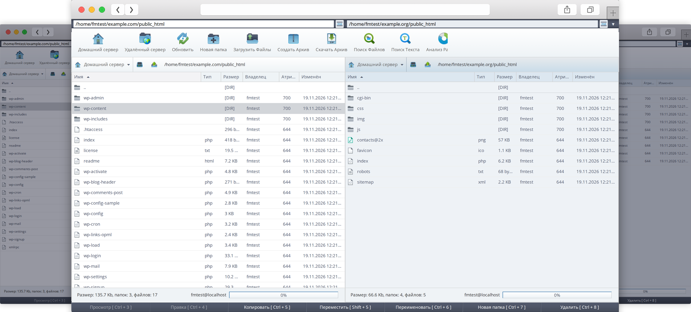

# Sprut.io Next

<sub>fork of Sprut.io file manager</sub>

Two-panel web file manager — fork of Beget's [Sprutio](https://github.com/LTD-Beget/sprutio).

**Unofficial fork.** Not affiliated with Beget; develops the original file manager to the author's taste.
[Русская версия](README.ru.md)



Thanks to the Sprut.io Team and Beget!

# What's different from the [original](https://github.com/LTD-Beget/sprutio)

- Fast search over SFTP (x100+) — text search in 10 000 files in 1 second
- An address bar for each panel: paste a path and go
- "Full path" (to the selected file) in one click
- Drag-and-drop upload of files and folders
- Optional new editor: code checking and AI suggestions (Ollama or an OpenAI-compatible API)
- Python 2.7 → Python 3.12

To stay true to the original, automated tests (API and in-browser E2E) are written against the original UI and logic.

## Installation

Requires a Linux server, Docker with Compose v2 and git.

```bash
git clone https://github.com/andres-website/sprutio-next.git
cd sprutio-next
sudo ./install.sh
```

Open `https://<server-address>:9443` and log in with the username and password of a user on this server
(self-signed certificate — the browser will warn you).

- Like the original, the file manager works with this server's files and users; every operation runs
  as the logged-in user. Logging in as root is possible if root has a password.
- Update: `git pull && sudo ./install.sh`. Stop: `sudo ./install.sh stop`, logs: `sudo ./install.sh logs`.
- Your own address for the Logout button (e.g. a hosting panel): `sudo FM_LOGOUT_URL=https://example.com ./install.sh`.
- Another port: `sudo FM_HTTPS_PORT=8443 ./install.sh` (or a `FM_HTTPS_PORT=8443` line in `.env` next to `install.sh`). The port is open to everyone — restrict it with a firewall if needed.
- AI suggestions "via the server" (OpenAI-compatible API; the key stays on the server):
  `sudo FM_AI_BASE_URL=https://api.openai.com/v1 FM_AI_MODEL=<model> FM_AI_API_KEY=<key> ./install.sh`.
  Ollama on the same server (started with `OLLAMA_HOST=0.0.0.0`):
  `FM_AI_BASE_URL=http://host.docker.internal:11434/v1 FM_AI_MODEL=qwen2.5-coder:1.5b`.
  `FM_AI_API=chat` — for models without FIM (uses /chat/completions).

### Try it without server access

A Docker stand with the `fmtest` test user — the server's own files and users are not touched:

```bash
stand/make-sandbox.sh && stand/dev.sh build-next && stand/dev.sh up-next
```

Log in at `https://<server-address>:9443` as `fmtest` with the `FM_TEST_PASS` password from `stand/.env`.

## Details

**Backend**
- Ported to Python 3.12 and Tornado 6; msgpack 1.x, redis-py 3+.
- SFTP, FTP and WebDAV verified against test servers.

**Search**
- Fast search (on by default): ripgrep / grep / find, locally and over SSH in a single command.
  On a 10 000-file project over SFTP with 40 ms ping, content search went from ~980 s to ~1 s.
  Falls back to the original search when the remote host has no shell tools.

**Interface**
- Path inputs above both panels (on the top menu bar): type or paste a path (`\` works too), Enter to go
  (a path to a file opens its folder and selects the file), Ctrl+L / Alt+D to focus. The ▾ button temporarily slides the original menu out below them.
- ⇢ / ⇠ button next to the input: open the same folder in the other panel, like in Total Commander.
- "Full path" button: copies the full path of the selected file to the clipboard and shows it
  so you can select a part of it.
- The editor and viewer open files up to 20 MB.
- The login page uses the browser language and switches language on the fly.
- Drag and drop files and folders from your computer onto a panel to upload them into its current folder; folders keep their structure.
- Sharper icons on Retina/4K screens where a native large version of the same artwork exists;
  an optional "Max retina mode" (Settings → Interface) for upscaled or custom icons.

**Editor** (Settings → "Editor+", off by default — the original Ace 1.2 stays)
- New Ace 1.45 with code checking (ace-linters: JS/TS, PHP, CSS/SCSS/LESS, HTML, JSON, YAML, XML, Lua) — errors
  and hints right in the text. The editor switches after a page reload.
- AI suggestions as grey text after the cursor: Tab — accept, Ctrl+→ — accept a word, Esc — dismiss, Alt+\ — ask.
  Source: Ollama straight from the browser (your own computer, `OLLAMA_ORIGINS=https://<server>:9443`) or
  an OpenAI-compatible API via the server (`FM_AI_*`). Qwen2.5-Coder 1.5B/3B/7B work well, for example.

## Repository layout

| Path | What |
|---|---|
| `sprutio/` | the application: `app` (Tornado web app), `rpc` (file system workers), `app/public/fm` (ExtJS 5 frontend), `vendor/` |
| `docker-compose.yml`, `install.sh` | server installation |
| `stand/` | Docker Compose test stand: original and new stack side by side, test SFTP/FTP/WebDAV servers |
| `tests/` | API tests, Playwright end-to-end tests, benchmarks |

The code of the three original repositories ([sprutio](https://github.com/LTD-Beget/sprutio),
[sprutio-rpc](https://github.com/LTD-Beget/sprutio-rpc),
[sprutio-frontend](https://github.com/LTD-Beget/sprutio-frontend)) lives here as one tree — see
[UPSTREAM.md](UPSTREAM.md) for the base commits.

## Tests

```bash
stand/run-tests.sh                  # API + E2E tests on the new stack (~7 min)
stand/dev.sh up-orig                # start the original images for comparison
FM_STACK=orig stand/run-tests.sh    # the same tests on the original
```

## Status

Work in progress; see [CHANGELOG.md](CHANGELOG.md). Production frontend rebuild (Sencha Cmd) is not set up yet:
frontend changes live in `fm-fork.js` / `fm-fork.css` and work with the shipped build.

Developed with the help of [Claude](https://claude.com) (Anthropic).

## License

GPL-3.0, as the original — see [sprutio/LICENSE.md](sprutio/LICENSE.md).
