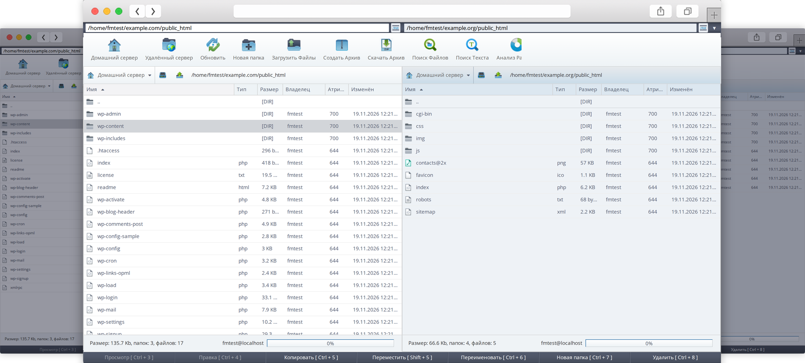

# Sprut.io Next

<sub>fork of Sprut.io file manager</sub>

Двухпанельный веб-файловый менеджер — форк [Sprutio](https://github.com/LTD-Beget/sprutio) от Beget.

**Форк неофициальный.** С Beget не связан, развивает оригинальный файловый менеджер на вкус автора. [English](README.md)



Спасибо Sprut.io Team и Beget!

# Отличия от [оригинала](https://github.com/LTD-Beget/sprutio)

- Быстрый поиск по SFTP (x100+) — поиск по тексту в 10 000 файлах за 1 секунду
- Адресная строка у каждой панели: вставил путь и перешёл
- «Весь путь» (до выбранного файла) одним кликом
- Загрузка файлов и папок перетаскиванием (Drag'n'Drop)
- Новый редактор по желанию: проверка кода и ИИ-подсказки (Ollama или OpenAI-совместимый API)
- Python 2.7 → Python 3.12

Для сохранения всего посконного и домотканого — написаны автотесты (API и E2E в браузере) по оригинальному UI и логике.

## Установка

Нужны Linux-сервер, Docker с Compose v2 и git.

```bash
git clone https://github.com/andres-website/sprutio-next.git
cd sprutio-next
sudo ./install.sh
```

Откройте `https://<адрес-сервера>:9443` и войдите логином и паролем пользователя этого сервера
(сертификат самоподписанный — браузер предупредит).

- Как у оригинала, файловый менеджер работает с файлами и пользователями этого сервера; все операции
  выполняются от имени вошедшего пользователя. Вход под root возможен, если у root задан пароль.
- Обновление: `git pull && sudo ./install.sh`. Остановить: `sudo ./install.sh stop`, логи: `sudo ./install.sh logs`.
- Свой адрес для кнопки «Выход» (например, панель хостинга): `sudo FM_LOGOUT_URL=https://example.com ./install.sh`.
- Другой порт: `sudo FM_HTTPS_PORT=8443 ./install.sh` (или строка `FM_HTTPS_PORT=8443` в файле `.env` рядом с `install.sh`). Порт открыт всем — при необходимости ограничьте его файрволом.
- ИИ-подсказки «через сервер» (OpenAI-совместимый API; ключ остаётся на сервере):
  `sudo FM_AI_BASE_URL=https://api.openai.com/v1 FM_AI_MODEL=<модель> FM_AI_API_KEY=<ключ> ./install.sh`.
  Ollama на этом же сервере (запущена с `OLLAMA_HOST=0.0.0.0`):
  `FM_AI_BASE_URL=http://host.docker.internal:11434/v1 FM_AI_MODEL=qwen2.5-coder:1.5b`.
  `FM_AI_API=chat` — для моделей без FIM (через /chat/completions).

### Попробовать без доступа к серверу

Стенд в Docker с тестовым пользователем `fmtest` — файлы и пользователи сервера не затрагиваются:

```bash
stand/make-sandbox.sh && stand/dev.sh build-next && stand/dev.sh up-next
```

Вход на `https://<адрес-сервера>:9443` — `fmtest` с паролем `FM_TEST_PASS` из `stand/.env`.

## Подробности

**Бэкенд**
- Перенесён на Python 3.12 и Tornado 6; msgpack 1.x, redis-py 3+.
- SFTP, FTP и WebDAV проверены на тестовых серверах.

**Поиск**
- Быстрый поиск (включён по умолчанию): ripgrep / grep / find — локально и по SSH одной командой.
  На проекте в 10 000 файлов по SFTP с пингом 40 мс поиск по содержимому — с ~980 с до ~1 с.
  Если на удалённом сервере нет нужных утилит — откат на оригинальный поиск.

**Интерфейс**
- Инпуты пути над обеими панелями (поверх верхней полосы меню): ввести или вставить путь (можно с `\`),
  Enter — перейти (путь к файлу открывает его папку и выделяет файл), Ctrl+L / Alt+D — фокус. Кнопка ▾ временно выдвигает оригинальное меню под ними.
- Кнопка ⇢ / ⇠ у инпута: та же папка открывается в другой панели, как в Total Commander.
- Кнопка «Весь путь»: копирует полный путь выделенного файла в буфер обмена и выводит на экран, чтобы выделить часть.
- Редактор и просмотр открывают файлы до 20 МБ.
- Страница входа сразу показывается на языке браузера, флаги переключают её на лету.
- Перетаскивание файлов и папок с компьютера на панель — загрузка в её текущую папку, папки со всей структурой.
- Чёткие иконки на экранах Retina/4K там, где есть родная крупная версия того же рисунка;
  «Режим max retina» (Настройки → Интерфейс) — для увеличенных или своих иконок.

**Редактор** (Настройки → «Редактор+», по умолчанию выключено — работает родной Ace 1.2)
- Новый Ace 1.45 с проверкой кода (ace-linters: JS/TS, PHP, CSS/SCSS/LESS, HTML, JSON, YAML, XML, Lua) — ошибки
  и подсказки прямо в тексте. Переключение — после перезагрузки страницы.
- ИИ-подсказки серым текстом после курсора: Tab — принять, Ctrl+→ — принять слово, Esc — убрать, Alt+\ — попросить.
  Источник: Ollama прямо из браузера (свой компьютер, `OLLAMA_ORIGINS=https://<адрес-сервера>:9443`) или
  OpenAI-совместимый API через сервер (`FM_AI_*`). Подойдут, например, Qwen2.5-Coder 1.5B/3B/7B.

## Устройство репозитория

| Путь | Что |
|---|---|
| `sprutio/` | приложение: `app` (веб-приложение на Tornado), `rpc` (воркеры файловой системы), `app/public/fm` (фронт на ExtJS 5), `vendor/` |
| `docker-compose.yml`, `install.sh` | установка на сервер |
| `stand/` | тестовый стенд на Docker Compose: оригинал и новый стек рядом, тестовые SFTP/FTP/WebDAV-серверы |
| `tests/` | API-тесты, E2E-тесты на Playwright, замеры |

Код трёх оригинальных репозиториев ([sprutio](https://github.com/LTD-Beget/sprutio),
[sprutio-rpc](https://github.com/LTD-Beget/sprutio-rpc),
[sprutio-frontend](https://github.com/LTD-Beget/sprutio-frontend)) лежит здесь одним деревом —
базовые коммиты в [UPSTREAM.md](UPSTREAM.md).

## Тесты

```bash
stand/run-tests.sh                  # API- и E2E-тесты на новом стеке (~7 мин)
stand/dev.sh up-orig                # поднять оригинальные образы для сравнения
FM_STACK=orig stand/run-tests.sh    # те же тесты на оригинале
```

## Состояние

В работе, см. [CHANGELOG.md](CHANGELOG.md). Пересборка production-фронта (Sencha Cmd) пока не настроена:
изменения фронта — в `fm-fork.js` / `fm-fork.css` и работают с поставляемой сборкой.

Разработано с помощью [Claude](https://claude.com) (Anthropic).

## Лицензия

GPL-3.0, как у оригинала — см. [sprutio/LICENSE.md](sprutio/LICENSE.md).
